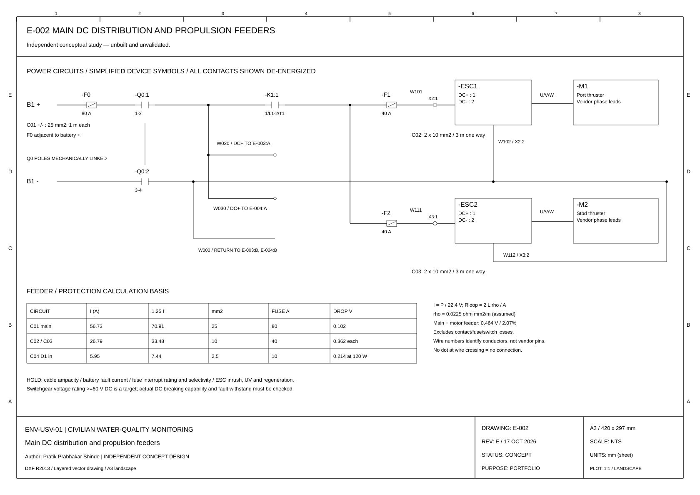

# USV Electrical Architecture

**Independent conceptual study — unbuilt and unvalidated.**

Electrical concept for a small civilian environmental-monitoring unmanned surface vessel. Prepared for Pratik Prabhakar Shinde as an independent engineering portfolio project. No Quantum Systems or other employer involvement is implied.

[Open the five-sheet A3 drawing set](pdf/USV_Electrical_Drawings_RevC.pdf) · [Editable DXF files](cad/) · [Calculation record](calculations/calculations.md)



## Drawing register

| Drawing | Description | Editable file | Preview |
|---|---|---|---|
| E-001 | Design basis, single-line architecture and power budget | [DXF](cad/E-001.dxf) | [SVG](previews/E-001.svg) |
| E-002 | Main DC distribution and propulsion feeders | [DXF](cad/E-002.dxf) | [SVG](previews/E-002.svg) |
| E-003 | 12 V services, field terminals and sensor interfaces | [DXF](cad/E-003.dxf) | [SVG](previews/E-003.svg) |
| E-004 | Propulsion-permit concept and proposed commissioning checks | [DXF](cad/E-004.dxf) | [SVG](previews/E-004.svg) |
| E-005 | Cable schedule, preliminary materials and drawing notes | [DXF](cad/E-005.dxf) | [SVG](previews/E-005.svg) |

Revision C is a concept design for engineering discussion. Five editable sheets cover electrical architecture, power distribution, services, a functional propulsion-permit path and material schedules. They are not construction or production documents. Simplified symbols are used; formal symbol-library conformity is not claimed.

## Purpose and engineering evidence

The study answers: **how would a small civilian USV distribute and protect its electrical power while keeping its monitoring equipment supplied?** The emphasis is electrical documentation and reasoning, not building a vessel or demonstrating autonomy.

| Work product | Evidence available | Not yet demonstrated |
|---|---|---|
| Architecture and power budget | E-001 and reproducible Python estimates | Actual hull/propulsion demand |
| Multi-line power distribution | E-002, device tags and circuit references | Selected-device connection drawings |
| Services and sensor interface | E-003, illustrative terminal allocation | Protocol compatibility or integration |
| Cable and protection sizing | Calculation record, cable take-off and candidate fuses | Verified ampacity, fault current or selectivity |
| Setting-to-work planning | E-004 and proposed test checklist | Any completed commissioning test |

[Engineering review and open issues](docs/engineering_review.md) identifies what must be resolved before detailed design. [Personal review worksheet](docs/personal_review.md) is for the candidate to complete before presenting the study.

## Design basis

- 2 h environmental monitoring in sheltered water, with visual supervision and recovery support.
- 25.6 V nominal / 100 Ah LiFePO4 pack; 22.4-29.2 V planning range.
- Two propulsion branches, each assumed 300 W cruise / 600 W peak electrical input.
- Regulated 12 V services: autopilot, GNSS, computer, telemetry, water-quality sensors and monitoring; 60 W baseline.

| Analytical result | Estimate | Main limitation |
|---|---:|---|
| Cruise demand at battery | 670.7 W | Assumed propulsion and hotel loads |
| Planning battery energy | 1,843 Wh | 80% usable SOC; separate 90% capacity allowance |
| Estimated endurance | 2.75 h | No hull/propeller model or measured duty cycle |
| Main + propulsion cable drop | 0.464 V / 2.07% | First-pass P/V; contact/device losses excluded |
| Endurance at 900 W total propulsion | 1.90 h | Two-hour target fails in this sensitivity case |

The calculations are analytical estimates. They are not dynamic simulations or hardware measurements. All commissioning checks are **NOT RUN**.

## Open in AutoCAD

1. Download the repository ZIP and extract it.
2. In AutoCAD, use **OPEN** and select a file under `cad/`. The files are DXF R2013 with editable CAD entities on named layers.
3. Use **ZOOM → Extents**. The sheet is drawn in model space using millimetres as paper coordinates, on an A3 landscape frame.
4. Review the text font substitution and lineweights. Plot A3 landscape, window around the 420 x 297 mm sheet, at 1:1, using a monochrome plot style. Electrical geometry is **NTS**, not a physical vessel layout.
5. Use **SAVEAS → DWG** if you need a native AutoCAD working copy. A DWG is not included because the drawings have not been opened, drafted or validated in AutoCAD.

DXFs were generated programmatically with Python/ezdxf. They were reopened and audited with ezdxf; a reopened main-distribution DXF was independently rendered for review. The PDF and SVGs are matching plots from the drawing generator. AutoCAD compatibility has not been checked in an AutoCAD installation.

## Design documents

- [Requirements, design decisions and interface allocation](docs/engineering_brief.md)
- [Full preliminary BOM](docs/preliminary_bom.md)
- [Proposed commissioning checklist](docs/commissioning_checklist.md)
- [Interview preparation](docs/interview_guide.md)
- [Revision and verification record](docs/revision_record.md)

## Reproduce the calculation and drawing files

```bash
python3 -m pip install -r requirements.txt
python3 calculations/calculate.py
python3 scripts/build_cad.py
```

`calculations/inputs.json` owns the numerical assumptions. The CAD generator reads the energy estimates from the calculation module. Schematic geometry, ratings and several annotations remain explicit design values. Changing the JSON does **not** automatically revise every CAD annotation. Review the calculations, tags, quantities and notes together before issuing another drawing revision.

## Review in manageable steps

1. Read E-001 and defend the 24 V choice and two-hour load assumption.
2. Reproduce the energy calculation and one feeder voltage-drop calculation by hand.
3. Open E-002 in AutoCAD, trace positive and return circuits, and make one small text/layer edit yourself.
4. Review E-003 terminal allocations and identify which selected-device pinouts are still missing.
5. Explain the E-004 stop/permit limits, then choose one commissioning test and describe the required evidence.

## Limits and provenance

This is an AI-assisted independent portfolio study. It does not demonstrate production harness release, automation software implementation, EPLAN experience, marine certification or hardware commissioning. Hull feasibility, actual load data, cable derating, fault current, fuse coordination, controller transients and a complete stop/reset/feedback design remain open.

Sources for the engineering method: [Victron Energy, Wiring Unlimited — DC wiring](https://www.victronenergy.com/media/pg/The_Wiring_Unlimited_book/en/dc-wiring.html) and [Blue Sea Systems, Circuit Protection](https://www.bluesea.com/resources/96). All load values and ampacities are project assumptions, not manufacturer specifications. Detailed provenance is recorded in the design brief.
